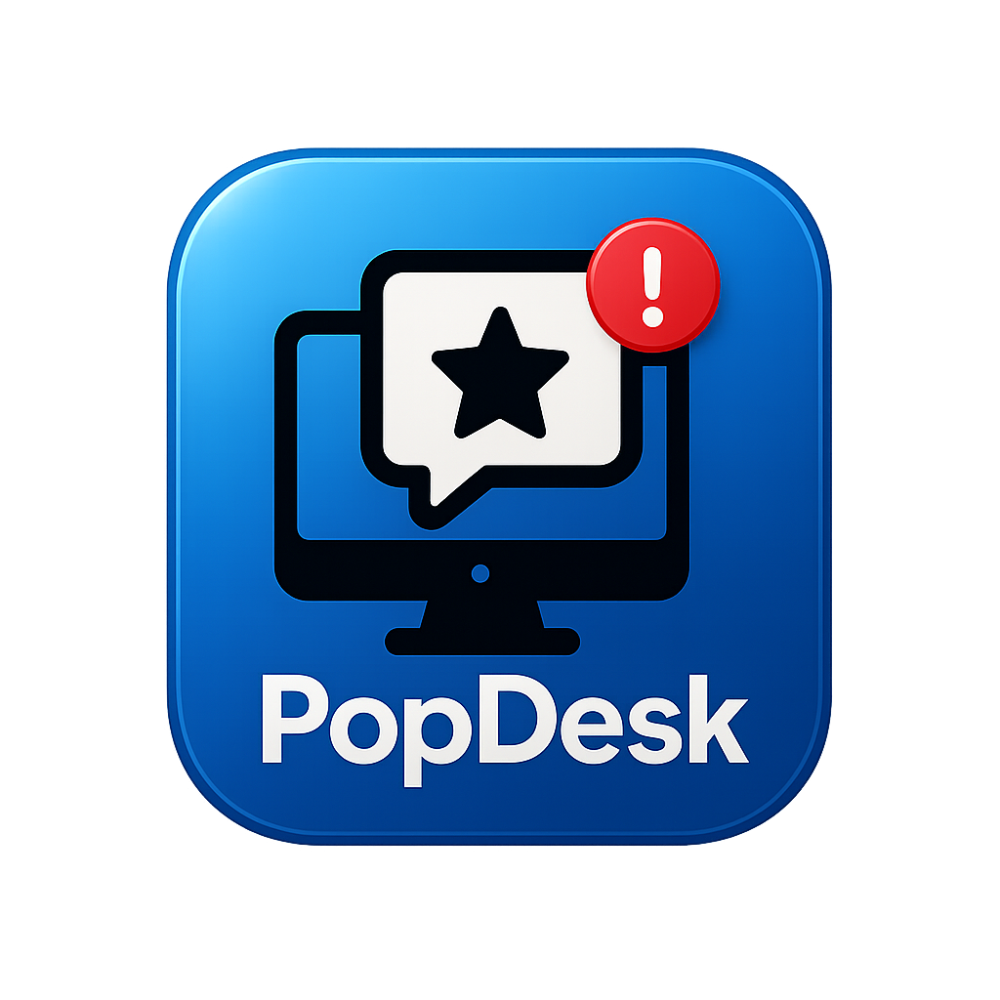
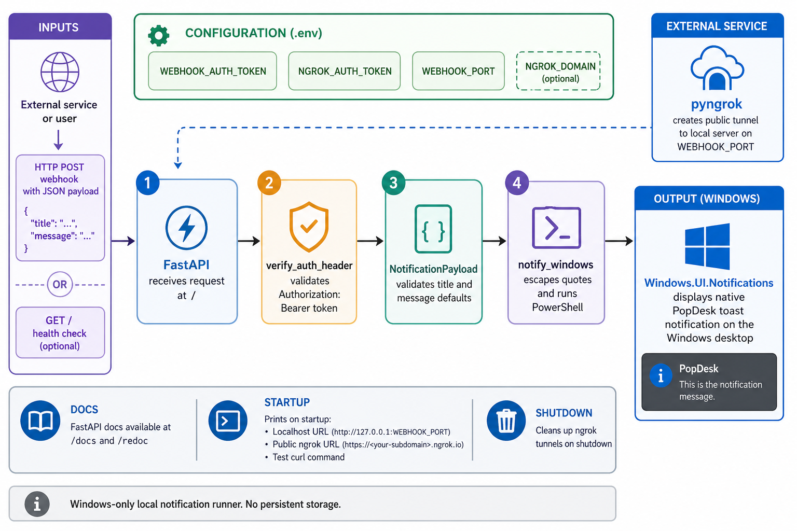

<p align="center">
  
  <br />
  <!-- repo-tagline:start -->
  <strong>🔔 Trigger Windows desktop notifications from anywhere via webhooks 🌐</strong>
  <!-- repo-tagline:end -->
</p>

popdesk is a small FastAPI webhook server that turns authenticated HTTP requests into native Windows toast notifications.

Run it on a Windows desktop, let pyngrok publish the local server, then send a `POST /` request from a script, CI job, monitor, or any service that can call a webhook.

## Install

```bash
git clone https://github.com/tsilva/popdesk.git
cd popdesk
uv sync --config-file uv.toml --frozen --all-groups
cp .env.example .env
uv run python main.py
```

Set the environment variables or edit `.env` before starting the server. Explicit environment values take precedence. Startup prints the local URL, public ngrok URL, and a test `curl` example with a token placeholder; replace the placeholder privately before use.

If a separate process manages the tunnel, point it at the loopback server and
start PopDesk with `uv run uvicorn main:app --host 127.0.0.1 --port 8000`.
Set `WEBHOOK_AUTH_TOKEN` for the server. The separate tunnel owns its login.

Dependency resolution keeps the seven-day release-age setting in `uv.toml` and
the security constraints in `[tool.uv]` in `pyproject.toml`. The lock includes patched OpenTelemetry tracestate parsing. Keep both files with
the committed `uv.lock` when updating dependencies.

## Commands

```bash
uv sync --config-file uv.toml --frozen --all-groups  # install the locked environment
uv audit --frozen                                      # audit the dependency graph
uv run ruff check main.py tests                        # lint source and tests
uv run pytest -q                                        # run security/regression tests
uv run python main.py                                   # start popdesk and open the ngrok tunnel
```

## Usage

Send a notification to the public ngrok URL printed at startup:

```bash
curl -X POST <public-ngrok-url> \
  -H "Authorization: Bearer <your-webhook-token>" \
  -H "Content-Type: application/json" \
  -d '{"title": "Build finished", "message": "The deployment job completed."}'
```

Endpoints:

| Method | Path | Auth | Purpose |
| --- | --- | --- | --- |
| `GET` | `/` | No | Health check |
| `POST` | `/` | Bearer token | Show a Windows toast notification |

The `POST /` payload accepts `title` and `message`. Both fields have defaults, so `{}` is valid.

## Notes

- Requires Python 3.10 or newer when using the `pyproject.toml`/`uv.lock` workflow.
- Requires Windows because notifications are sent through PowerShell and `Windows.UI.Notifications`.
- Requires `WEBHOOK_AUTH_TOKEN` in the environment or `.env`.
- `python main.py` also requires `NGROK_AUTH_TOKEN` for its built-in tunnel.
- Optional settings are `WEBHOOK_PORT` and `NGROK_DOMAIN`.
- FastAPI docs are available locally at `/docs` and `/redoc` while the server is running.
- popdesk does not persist webhook payloads or notification history.

## Architecture



## License

[MIT](LICENSE)
